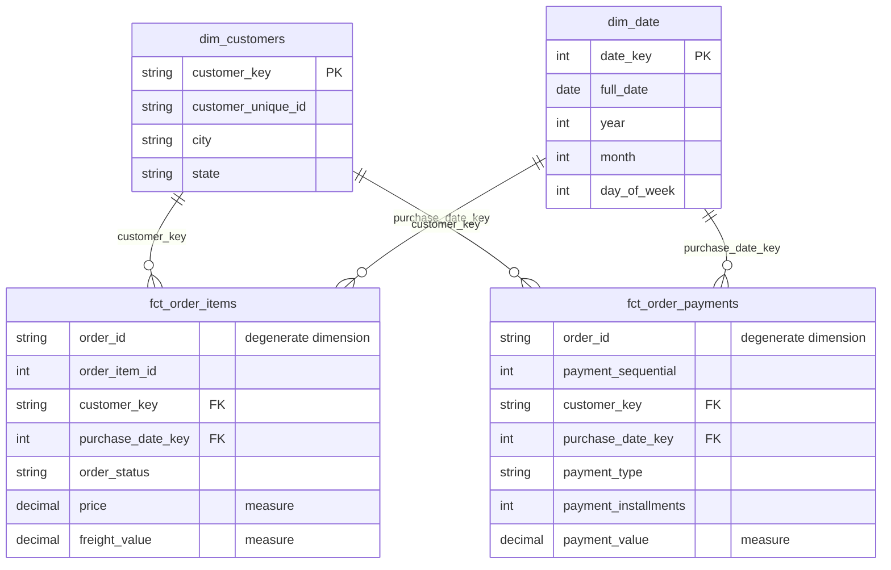

# Star Schema (MVP)

## Grain decisions

- `fct_order_items`: one row per order item (`order_id` + `order_item_id`).
- `fct_order_payments`: one row per payment (`order_id` + `payment_sequential`).
  Kept as a separate fact because payments are at order level. Joining them into
  `fct_order_items` would repeat the payment value on every item row and inflate sums.
- `dim_customers`: one row per real customer (`customer_unique_id`).
  In Olist, `customer_id` is generated per order, so it cannot identify a person.
- `dim_date`: one row per calendar day.

